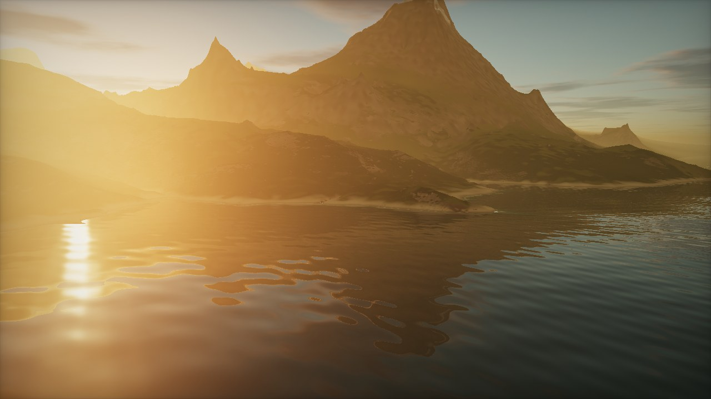
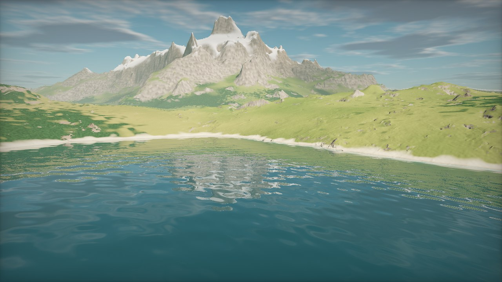
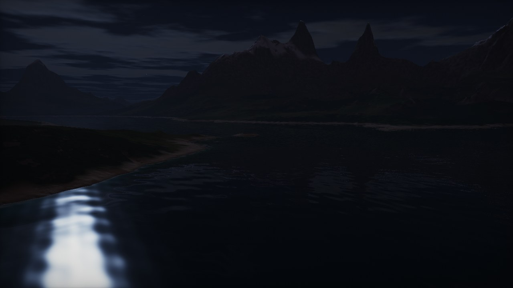
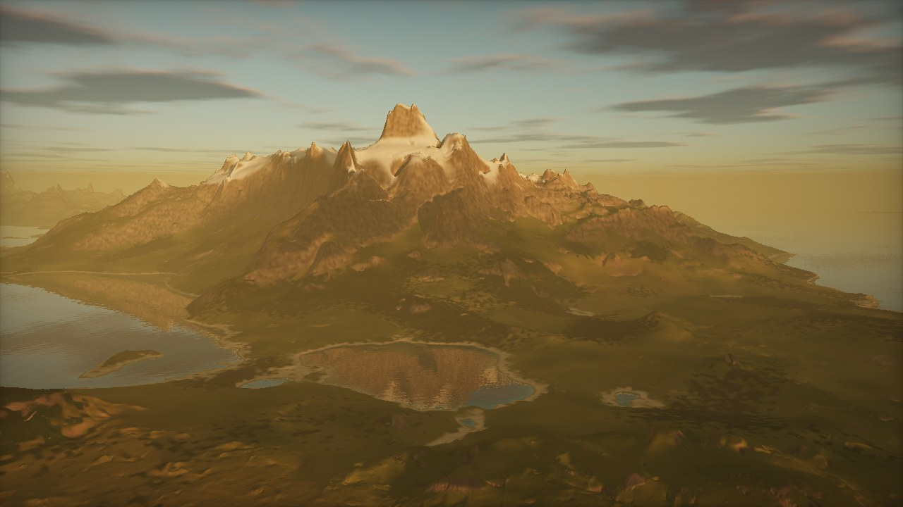

# Halcyon

Worlds computed from nothing but math, in real time, in your browser.

Built entirely by Claude (Anthropic's AI) — one HTML file, zero images, zero models, zero libraries.

## The planet (coming in this update)

_Placeholder: a whole procedural planet you dive into from orbit. Details coming soon._

## The flyable world



**Live: [jcorrea510.github.io/duettesting/world](https://jcorrea510.github.io/duettesting/world/)**

An endless, flyable landscape. Every mountain, wave, cloud and sunset you see is computed from scratch for every pixel, every frame, by two fragment shaders. There is no terrain mesh, no image texture and no skybox in the app. The whole thing is a single `index.html` of roughly 60 KB, about 450 lines of which are GLSL.

| Afternoon | Moonlit night | From altitude |
| --- | --- | --- |
|  |  |  |

The screenshots are frames captured from the app itself with the interface hidden. To open the same places: [sunset, world 7](https://jcorrea510.github.io/duettesting/world/#seed=7&t=0.742), [afternoon, world 1234](https://jcorrea510.github.io/duettesting/world/#seed=1234&t=0.6), [night, world 31337](https://jcorrea510.github.io/duettesting/world/#seed=31337&t=0.765), [from altitude, world 1234](https://jcorrea510.github.io/duettesting/world/#seed=1234&t=0.742&cam=16085,-16425,0.785,420). The camera starts flying as soon as the page loads.

### What you're looking at

**Terrain.** The ground is a height function `h(x, z)` built from value noise with analytic derivatives. Each octave's contribution is damped by the accumulated slope of the octaves below it, which produces erosion-like ridges and smooth valleys without simulating erosion. The ray march uses 8 octaves (9 when rendering a photo), dropping to fewer octaves with distance as a level-of-detail scheme; surface normals near the camera use up to 12. A second, very low-frequency noise decides where continents, islands and open sea go. The hash is integer-based, so every GPU produces the same world for the same seed.

**Finding the surface.** Each pixel's ray marches through the heightfield, taking larger strides when it is far above the ground and bisecting back when it oversteps a cliff. Rays that start above a fixed ceiling higher than any peak skip straight down to it.

**Sky.** A separate shader integrates single scattering through a 60 km atmosphere around a 6,360 km planet: Rayleigh scattering (β = 5.5, 13.0, 22.4 × 10⁻⁶ m⁻¹, scale height ≈ 8 km) and Mie scattering (scale height 1.2 km, Cornette–Shanks phase function, g = 0.78), with 20 samples along each view ray and 8 toward the sun. The result is baked every frame into a 256×128 lookup table, which the main shader reads for the sky, ambient light and aerial perspective. The sun's own color comes from the same model's transmittance, computed on the CPU.

**Light and shadow.**
- Soft sun shadows from a second ray march toward the sun; how closely it grazes the terrain sets the penumbra.
- A drifting cloud layer at 1,900 m (5 octaves of noise) that is lit and self-shadowed, and casts moving shadows on the ground.
- Heightfield ambient occlusion, sky light and a ground-bounce term.
- Materials from slope, altitude and noise: beaches, grass, forest, layered rock, and snow that only settles on flat high ground.
- Exponential valley fog integrated analytically along each ray.

**Water.** The sea knows its depth everywhere, because the terrain function is evaluated beneath it. Light is absorbed per color channel with depth, so shallow lagoons read turquoise and deep water turns navy. Waves are a small set of directional waves following the deep-water dispersion relation ω = √(gk). Reflections use Schlick's Fresnel approximation, and nearby islands are reflected with a second terrain ray march. Foam gathers where the depth approaches zero at the shoreline.

**Night.** After sunset the key light becomes a moon, so the world keeps its shadows; stars are hashed into the sky and exposure adapts.

**Keeping it smooth.** The page measures its own frame time and continuously adjusts internal resolution (capped at about 2.4 megapixels) to hold a steady frame rate. A JavaScript mirror of the terrain function lets the autopilot read the ground ahead, climb over ridges and drift toward coastlines and mountains. The photo button re-renders the current view at higher quality in 256-pixel tiles, producing a 3840×2160 PNG (2560×1440 on touch devices) without stalling the GPU.

### Controls

| Input | Action |
| --- | --- |
| Drag | Look around (horizontal drags also steer) |
| `W` / `S` or `↑` / `↓` | Speed up / slow down |
| `A` / `D` or `←` / `→` | Steer |
| `E` or `Space` / `Q` or `C` | Climb / descend |
| Scroll or pinch | Altitude |
| `T` | Timelapse |
| `N` | New world |
| `P` | Save a 4K photo |
| `H` | Hide the interface |
| `I` | How it works |
| `[` / `]` | Step the time of day |

Leave the controls alone and the autopilot flies on its own. The Share button copies a link that reopens the exact world, hour and viewpoint, using the URL hash parameters `seed`, `t` (time of day, 0 to 1) and `cam` (x, z, heading, altitude).

## Running it locally

Everything is static. Open `world/index.html` directly in a recent Chrome, Edge, Firefox or Safari, or serve the repository with any static server:

```sh
python3 -m http.server
```

then visit http://localhost:8000/world/. A WebGL2-capable GPU is required.
